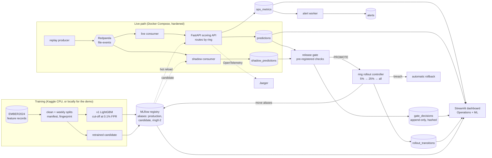
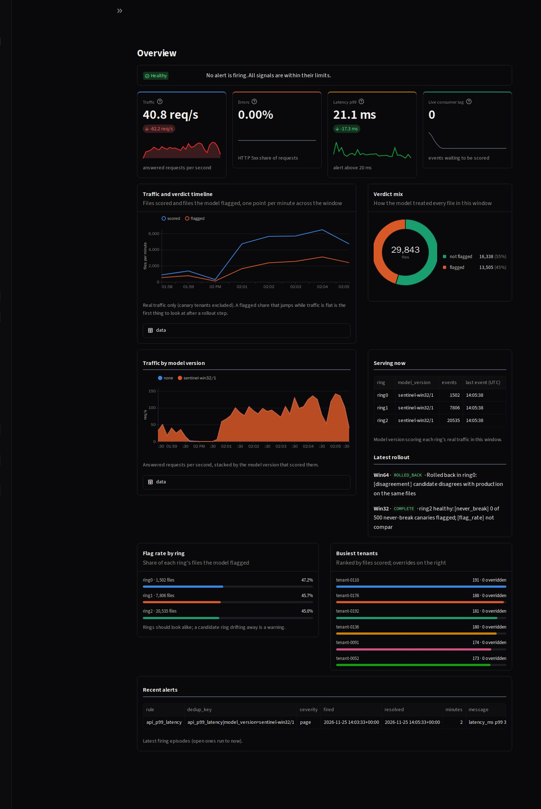
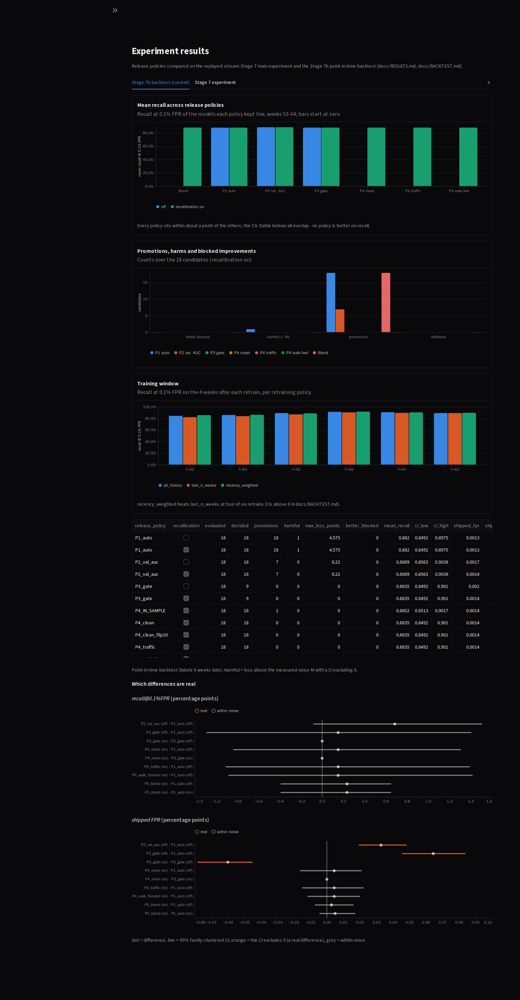

# Sentinel Gate

**Safe deployment for malware-detection models.** Sentinel Gate decides whether a newly retrained malware model is safe to replace the one in production. If it is, the model is rolled out ring by ring, and it is rolled back automatically when something goes wrong.

Built on the public **EMBER2024** feature records (Win64 and Win32 PE files). No real malware binaries are ever downloaded or run: the project only uses pre-extracted numeric feature vectors.

**In one sentence:** retraining a malware detector is routine, but shipping a worse one is easy to miss. Sentinel Gate does five things with every retrain:
1. shadow-scores it on live traffic;
2. judges it with pre-registered statistics at a fixed 0.1% false-alarm rate;
3. rolls it out to 5% → 25% → everyone;
4. rolls it back on its own;
5. records every decision in append-only tables.

It also measures, honestly, whether that machinery is worth its cost ([BACKTEST.md](docs/BACKTEST.md)).

**Try it in one command:** `make demo` builds the whole release path on a small dataset in an isolated stack, in about 9 minutes ([Quick start](#quick-start)).

> **Status (2026-11-25):**
> - All stages (0–10) are done, including the Stage 7b backtest.
> - CI (GitHub Actions) is left out by owner decision.
>
> Progress is in [docs/PROGRESS.md](docs/PROGRESS.md); known weak points are in [docs/LIMITATIONS.md](docs/LIMITATIONS.md).

---

## Table of contents

1. [Why this exists](#why-this-exists)
2. [How it works](#how-it-works)
3. [Architecture](#architecture)
4. [Key results](#key-results)
5. [Screenshots](#screenshots)
6. [Quick start](#quick-start)
7. [Everyday commands](#everyday-commands)
8. [The pipeline stage by stage](#the-pipeline-stage-by-stage)
9. [Scoring API](#scoring-api)
10. [Configuration](#configuration)
11. [Data rules (no leakage)](#data-rules-no-leakage)
12. [Security and safety](#security-and-safety)
13. [Testing and code quality](#testing-and-code-quality)
14. [Repository layout](#repository-layout)
15. [Documentation index](#documentation-index)
16. [Known limitations](#known-limitations)

---

## Why this exists

Malware detectors decay: new families appear and benign software changes, so models are retrained regularly. Shipping every retrain blindly is risky, because a new model can look better on validation data and still be worse in production. It can:
- miss more malware at the same false-alarm rate;
- flag files that must never be flagged (critical benign software);
- or simply behave very differently from the model users rely on.

Sentinel Gate treats a model release like a production change:

1. **Shadow-score** the candidate on real traffic next to the production model.
2. **Gate** it with fixed, pre-registered statistical checks at a fixed operating point (0.1% false-positive rate).
3. **Roll it out in rings** (5% → 25% → everyone), watching live health signals.
4. **Roll back automatically** on any breach, and give operators a kill switch that restores every ring in under a second.
5. **Record everything** in append-only audit tables, with the seed, data fingerprint and git commit behind each decision.

## How it works



**Gate checks:** recall at 0.1% FPR, FPR at the shipped cut-off, never-break files, weekly drop, McNemar on disagreements, and calibration.

**Rollout signals:** never-break canaries, flag rate, error rate, p99 latency and paired-scoring disagreement. A kill switch (`POST /admin/rollback`) restores every ring at once.

**The model.**
- v1 is LightGBM trained on weeks 1–47 and calibrated on weeks 48–51, with week 52 held out for evaluation.
- Its decision threshold is set for a **0.1% false-positive rate**, not 0.5.
- A logistic-regression baseline is kept for comparison.

**Time is sacred.**
- EMBER2024 has 52 training weeks and 12 test weeks (53–64).
- Every split, threshold and decision uses only information available at that point in time.
- Labels also arrive late, on a seeded delay of 7–28 days.

## Architecture

All services run with Docker Compose. Every container is hardened: a read-only root filesystem, all capabilities dropped, `no-new-privileges`, and a non-root user. Ports bind to `127.0.0.1` only.

| Service | Role | Local URL |
|---|---|---|
| `api` | FastAPI scoring service, 4 uvicorn workers. Hot-reloads models from MLflow aliases, routes by ring, writes lineage | http://127.0.0.1:18080 |
| `postgres` | `predictions`, `shadow_predictions`, `gate_decisions`, `rollout_transitions`, `ops_metrics`, `alerts` (audit tables are append-only via triggers) | 127.0.0.1:5432 |
| `mlflow` | Model registry (SQLite + file artifacts in `$SENTINEL_DATA_DIR/mlflow`) | http://127.0.0.1:5000 |
| `redpanda` | Kafka-compatible stream of file events (`file-events`) | internal |
| `live-consumer` / `shadow-consumer` | Score each event with production (through the API) and with the candidate | internal |
| `producer` | Replays test weeks onto the stream on demand (`make replay`) | on demand |
| `jaeger` | Distributed traces (consume → score → log) via OpenTelemetry | http://127.0.0.1:16686 |
| `alert-worker` | Consumer lag, alert rules, metric retention/downsampling | internal |
| `dashboard` | Streamlit app: Operations (Overview, Service Health, Model Live, Alerts) and ML (ML Overview, Model Registry, Gate Decisions, Head-to-head, Drift, Rollout Timeline, Experiment Results, Prediction Lookup), with shared filters | http://127.0.0.1:8501 |

Observability deliberately uses **PostgreSQL `ops_metrics` + Jaeger + Streamlit only**: there is no Prometheus and no Grafana.

Each component has its own least-privilege database role: `sentinel_api`, `sentinel_shadow`, `sentinel_gate`, `sentinel_rollout`, `sentinel_monitor` and `sentinel_dashboard` (read-only).

## Key results

These numbers are measured, not targets. Full details are in the linked documents.

| Area | Result | Source |
|---|---|---|
| Baseline (Win64, week 52) | LightGBM v1 recall **89.70%** [88.83, 90.51] at measured FPR 0.36%; AUC 0.9982. LR baseline: 59.74%. 0/500 never-break files flagged | [BASELINE.md](docs/BASELINE.md) |
| Threshold drift | The fixed cut-off hits 0.097% FPR on its calibration weeks, but 0.36% on week 52 and ~0.20% on the test weeks. Benign scores drift | [PROGRESS.md](docs/PROGRESS.md) |
| Release gate | First real decisions: Win64 v2 vs v1 → **REJECT**; Win32 v2 vs v1 → **REJECT** | [docs/gate/](docs/gate/) |
| Ring rollout demo | A bad model (0.5 cut-off) was rolled back in ring0 after 27.5 s, caught by the never-break canaries. The kill switch restored every ring in **0.65 s** | [ROLLOUT_DEMO.md](docs/ROLLOUT_DEMO.md) |
| Main experiment (18 candidates) | Naive harm count: P1 auto-promote 5/18, P2 4/17. Gate 0/2, but it blocked 5 of 7 better candidates. **Superseded by 7b:** those harms are within noise | [RESULTS.md](docs/RESULTS.md) |
| Point-in-time backtest (7b) | Labels 6 weeks late; noise margin M = 2.76 points; family-clustered CIs. Only **1 real harm** (P1, 4.57 points, live 14 days). **No release policy differs on recall** (every CI includes 0). Weekly capped recalibration removes the real false-alarm gap (P3: −0.060 pp). `recency_weighted` beats `last_n_weeks` at 4 of 6 retrains. P4 as specified shipped nothing | [BACKTEST.md](docs/BACKTEST.md) |
| Load test | 0 failures and 0 lost rows, but 306 req/s peak against a 500 req/s target; p99 above 20 ms. **Target not met** on the 8-core dev laptop | [LOAD_TEST.md](docs/LOAD_TEST.md) |
| Dashboards | 12 pages (4 Operations + 8 ML) render live data; most load in 0.1–2.6 s on a warm cache | [PROGRESS.md](docs/PROGRESS.md) |
| `make demo` | PDF, two models, replay of 12 weeks, gate decision (REJECT), dashboards filled: **538 s** on the dev laptop with the real stack also running. `make demo-rollout`: a bad model rolled back in ring0 by canaries in about 35 s | [PROGRESS.md](docs/PROGRESS.md) |

**What the evidence recommends:**
- retrain with `recency_weighted`;
- promote on schedule (or with the cheap validation-AUC check);
- keep weekly capped recalibration;
- rely on the ring rollout and its canaries as the safety net.

The full release gate and P4 add delay without a measurable recall benefit on this stream ([BACKTEST.md](docs/BACKTEST.md), [LIMITATIONS.md](docs/LIMITATIONS.md)).

## Screenshots

The Streamlit dashboard (http://127.0.0.1:8501) has four sections: Observe, Intelligence, Enforce and Operate. Shown on the real Win64/Win32 stack.

**Overview: is the service healthy right now?** KPI cards, files scored vs flagged per minute, the verdict mix, flag rate per ring and the busiest tenants. Captured while Win32 week 64 (30,000 events) was replayed.



**ML Overview: where is each model in the release path?** Production → candidate (shadow) → release gate → ring rollout → backtest verdict, each card with the evidence it last produced.


**Gate Decisions: why was a release blocked?** Every decision by outcome, the checks that block most often, then one decision's evidence: interval bars, McNemar tables, the files the models disagree on, and a bundle-hash check.


**Rollout Timeline: what happened in each rollout?** Outcomes, the signals that triggered rollbacks, the state of each ring over time, and the flag rate per ring during the rollout.


**Experiment Results: is the release machinery worth it?** The Stage 7b point-in-time backtest: recall per release policy (no real difference), promotions and harms, the training-window comparison, and which differences are statistically real.



**One request in Jaeger:** the live consumer's span, the API's `POST /v1/score`, then `score` → `log`.


## Quick start

### Prerequisites

- Docker Desktop (with Compose v2) and GNU Make. On Windows, run `make` from Git Bash with `MSYS_NO_PATHCONV=1`.
- About 30 GB of free disk space **outside** any OneDrive-synced folder, for the dataset and registry.
- No host Python is needed: every tool runs inside the hardened sandbox image.

### 1. Configure

```bash
cp .env.example .env
# edit .env:
#   SENTINEL_DATA_DIR=C:/Users/<you>/sentinel-data   (outside OneDrive)
#   one strong random password per database role, e.g. openssl rand -hex 24
#   SENTINEL_ADMIN_API_KEY=<random>                  (kill switch)
```

`.env` is never committed; `.env.example` holds placeholders only.

### 2. Build the sandbox

```bash
make setup          # builds sentinel-sandbox:dev (non-root, read-only, no network by default)
make lint test      # ruff + mypy --strict + unit tests, all inside the sandbox
make secrets-scan   # gitleaks over the working folder (pinned image, read-only, no network)
```

### 2b. The fast path: `make demo` (about 9 minutes)

```bash
make demo           # PDF splits -> v1 + candidate -> isolated stack -> replay 12 weeks -> gate
make demo-rollout   # optional (+1.5 min): ring rollout of a deliberately bad model, rolled back
make demo-down      # remove the demo stack and its database volume
```

**What the demo does:**
- Runs everything in a **separate** compose project (`sentinel-demo`), with data in `$SENTINEL_DATA_DIR/demo`. Its URLs: dashboard http://127.0.0.1:8502, API :18081, MLflow :15000, Jaeger :16687.
- Never touches the real stack, registry or `docs/`.
- Uses PDF, whose splits are small; if they are missing it downloads and cleans them first.
- Trains with fewer, smaller trees. The gate runs at 1% FPR because a PDF week has only about 500 benign files. These demo-only settings are in `configs/demo/` (an overlay switched on with `SENTINEL_CONFIG_OVERLAY=demo`).

It demonstrates the pipeline; it is not a result.

### 3. Get data and models (the real Win64/Win32 run)

The heavy steps (downloading, cleaning and training on ~2 million records) run in **Kaggle/Colab notebooks** from the code bundle:

```bash
make bundle         # dist/sentinel_gate_code.zip  (code only: no data, no .env, no .git)
```

Upload the bundle as a Kaggle dataset, run the notebook for the stage you need (see [`notebooks/`](notebooks/)), and download the result zip. Then register it locally:

```bash
make train BUNDLE=/path/to/sentinel_stage2_Win64.zip           # v1 -> alias `production`
make import-replay ZIP=/path/to/sentinel_stage4_replay_Win64.zip
make register-candidate BUNDLE=/path/to/sentinel_stage4_candidate_Win64.zip
```

If a path contains spaces, copy the zip to a folder without spaces first.

### 4. Run the stack

```bash
make up             # builds sentinel-app:dev and starts every service
make migrate        # only on an existing database created by an older stage
make rollout-init   # creates ring0/1/2 aliases pointing at production
make sample-request # builds a real request body from feature records
make test-integration
```

Then open the dashboard at http://127.0.0.1:8501 and traces at http://127.0.0.1:16686.

### 5. Exercise the release path

```bash
make replay WEEKS="53 54 55" EPS=300   # stream test weeks: live + shadow scoring
make gate CANDIDATE=2                  # release decision -> docs/gate/*.md + gate_decisions
make gate-verify                       # re-hash stored decisions (tamper check)
make rollout CANDIDATE=2               # ring-by-ring rollout with automatic rollback
make rollout-status
make kill-switch REASON="operator test"
make down
```

## Everyday commands

Run `make help` for a short list. Every target runs inside the hardened sandbox or the compose stack.

| Group | Targets |
|---|---|
| Setup & quality | `setup`, `sandbox`, `lock`, `lint`, `format`, `test`, `test-integration`, `secrets-scan` |
| Demo (Stage 10) | `demo`, `demo-rollout`, `demo-down` |
| Data (Stages 0–1) | `download`, `inspect`, `report`, `data`, `clean-data`, `cleaning-report`, `bundle` |
| Models (Stage 2) | `train BUNDLE=`, `baseline-report`, `train-smoke` |
| Stack (Stage 3) | `up`, `down`, `migrate`, `sample-request` |
| Replay & shadow (Stage 4) | `import-replay ZIP=`, `register-candidate BUNDLE=`, `replay WEEKS=`, `replay-counts`, `replay-check` |
| Gate (Stage 5) | `gate CANDIDATE= [FILE_TYPE=] [GATE_WEEKS=]`, `gate-verify` |
| Rollout (Stage 6) | `rollout-init`, `rollout CANDIDATE= [DEMO=1]`, `rollout-watch`, `rollout-status`, `kill-switch`, `rollout-timeline OUT=`, `demo-models`, `demo-reset` |
| Experiment (Stage 7) | `v1-zip`, `experiment-import ZIP=`, `experiment [RESAMPLES=]` |
| Observability + dashboards (Stages 8-9) | `dashboard`, `dashboard-check [LOOKUP=<file_id>]`, `ml-results`, `load-bodies`, `load-test`, `load-report`, `load-bench`, `load-render`, `profile-api`, `db-outage-check` |
| Backtest (Stage 7b) | `backtest-import-meta ZIP=`, `backtest-import ZIP=`, `backtest-pass1 [RESAMPLES=]`, `backtest-pass2 [RESAMPLES=]` |

## The pipeline stage by stage

| # | Stage | What it delivers |
|---|---|---|
| 0 | Repo setup & dataset check | Sandbox, tooling, verified EMBER2024 downloads (SHA-256), [DATASET_REPORT.md](docs/DATASET_REPORT.md). Win64 + Win32 chosen because only they have ≥ 50,000 benign test files, enough to measure a 0.1% FPR |
| 1 | Cleaning & data contracts | Pandera schema, logged cleaning steps (row counts before/after), weekly Parquet splits, `manifest.json` with a data fingerprint, a 500-file **never-break** set taken from training weeks, simulated late labels. See [CLEANING_REPORT.md](docs/CLEANING_REPORT.md) |
| 2 | Baseline models | LightGBM + LR, threshold at 0.1% FPR, Wilson intervals, calibration (ECE), MLflow registry with alias `production`, golden-metrics test |
| 3 | Serving | FastAPI scoring service, hot reload by alias, lineage table, tenant overrides, health/readiness probes |
| 4 | Replay & shadow scoring | Redpanda stream of test weeks; live and shadow consumers, idempotent on `event_id`, so replaying a week twice does not duplicate rows |
| 5 | Release gate | Pre-registered checks (below), McNemar test, evidence bundles hashed into append-only `gate_decisions` |
| 6 | Ring rollout & rollback | Per-ring aliases, a controller with never-break canaries, Wilson-bounded health signals, an auto-rollback state machine, a kill switch |
| 7 | Main experiment | 18 retrained candidates (3 retraining policies × 6 retrain weeks) replayed under 3 release policies, with bootstrap CIs; paired-scoring rollout signal |
| 7b | Release-policy backtest | Point-in-time re-run: 6-week label delay, family-clustered bootstrap, harm margin from measured noise, capped weekly recalibration, P1–P4 policies, walk-forward, blend, drift test. Result: no policy differs on recall; recalibration and the training window matter more |
| 8 | Observability, alerts, load | `ops_metrics`, OpenTelemetry → Jaeger, alert rules (p99, error rate, consumer lag, never-break), retention, Streamlit ops dashboard, Locust load test |
| 9 | ML dashboard | Eight ML pages reading PostgreSQL, MLflow and the results folder only: registry with gate outcomes, gate evidence viewer with hash verification, head-to-head ROC/PR/calibration, drift heatmap, rollout timeline, experiment results, prediction lineage |
| 10 | Hardening & handover | `make demo` (isolated PDF stack, about 9 min) + `make demo-rollout`, config overlay, gitleaks (pre-commit + `make secrets-scan`), dashboard SQL integration tests, README, reviewer pass ([LIMITATIONS.md](docs/LIMITATIONS.md)). CI left out by owner decision |

### The release gate (Stage 5)

Policy: [configs/gate_policy.yaml](configs/gate_policy.yaml), version `1.0.0`. Every rule is fixed before it is run on the weeks it judges.

| Check | Rule |
|---|---|
| (a) Recall | Candidate recall at **0.1% FPR** ≥ production's |
| (a′) Shipped FPR | Candidate FPR at its shipped cut-off ≤ production's × 1.10 |
| (b) Evidence | At least 30 discordant files; McNemar at 95% confidence; ≥ 99% of events carry both a live and a shadow score |
| (c) Never-break | 0 never-break files flagged |
| (d) Weekly floor | In no week does recall fall more than 2 points below production's |
| (e) Calibration (soft) | ECE increase ≤ 0.01 (reported; it does not block) |
| Late labels | The gate decides 28 days after the last evaluated week and uses only labels known by then |

The possible outcomes are `PROMOTE`, `REJECT` and `INSUFFICIENT_EVIDENCE`. A `PROMOTE` moves only the `candidate_approved` alias; it never touches `production` directly.

### Ring rollout (Stage 6)

Policy: [configs/rollout.yaml](configs/rollout.yaml).

**Rings** are assigned by a stable hash of the tenant ID: ring0 gets 5% of tenants, ring1 25%, and ring2 the rest.

**When a ring advances:** only after the candidate has served at least 300 / 1,500 / 3,000 real files there, has scored all 500 never-break canaries, and passes every one of these signals:
- **Never-break canaries:** 0 hits allowed.
- **Flag rate:** at most +10% relative to production, judged on Wilson bounds.
- **Error rate:** 5xx responses ≤ 1%.
- **Latency:** p99 ≤ 2 × production's p99 + 25 ms.
- **Paired-scoring disagreement:** at most +1 point over the rate the gate approved.

Any breach rolls the rollout back immediately.

## Scoring API

| Method & path | Purpose |
|---|---|
| `POST /v1/score` | Score one file: `{file_id, tenant_id, features[], feature_schema_version, event_id?}` → `score`, `verdict`, `model_version`, `threshold`, `override_applied`, `request_id` |
| `GET /v1/models` | Models currently loaded, per file type |
| `GET /v1/rings` | Which version each ring serves (header `X-Sentinel-Worker` identifies the worker) |
| `GET /v1/ops/stats` | Request and latency counters |
| `POST /admin/rollback` | Kill switch (requires `X-API-Key`) |
| `GET /healthz`, `GET /readyz` | Liveness / readiness |

Requests are routed to the right model by `feature_schema_version`. Unknown fields are rejected with 422. Lineage rows are written in the background with a bounded queue, so a database outage never blocks scoring (`make db-outage-check` verifies this).

## Configuration

All settings live in [`configs/*.yaml`](configs/) and are loaded through typed Pydantic models in [src/sentinel/config.py](src/sentinel/config.py). There are no magic numbers in the code.

| File | Controls |
|---|---|
| `data.yaml`, `clean.yaml` | Dataset source, file types, cleaning rules, never-break rule, late-label delay |
| `train.yaml` | Training/calibration windows, target FPR, LightGBM/LR parameters, MLflow names |
| `serving.yaml` | Alias, poll interval, workers, lineage batching, overrides |
| `replay.yaml` | Stream topics, ring shares, tenants |
| `retrain.yaml` | Retraining policies (`last_n_weeks`, `all_history`, `recency_weighted`) and label delay |
| `gate_policy.yaml` | Release-gate rules (versioned) |
| `rollout.yaml` | Ring thresholds, canaries, health signals |
| `experiment.yaml` | Stage 7 experiment setup |
| `backtest.yaml` | Stage 7b: 6-week label delay, harm margin, recalibration cap, P4 parameters |
| `monitoring.yaml`, `alert_rules.yaml` | Metric windows, tracing, retention, alert rules |

Secrets and paths come from `.env` (see [.env.example](.env.example)).

## Data rules (no leakage)

- **Test weeks (53–64) are never used** for training, tuning, thresholds or calibration of v1 or of any reported baseline.
- **Late labels:** a model trained at time *T* only uses rows whose labels were available by *T*.
- **Retrained candidates (Stage 4+):** a candidate retrained at simulated week *T* may learn from any week whose labels are known by *T*. Its threshold uses weeks ≤ *T* only, and it is judged only on weeks after *T*.
- **Backtest (Stage 7b):**
  - labels arrive 6 weeks late, so a decision at week *t* sees only labelled weeks ≤ *t* − 6;
  - the live model's cut-off may be recalibrated weekly on benign files whose labels are known at *t*;
  - margins, tolerances and gate thresholds are never tuned on the weeks they judge.
- **Leakage test:** a test fails if any test-week row hash appears in a training week.
- **Reproducibility:** seeds are fixed. Every result file records the seed, the data fingerprint and the git commit.

## Security and safety

- **No malware binaries, ever.** Only `joyce8/EMBER2024` feature records are used; the EMBER2024-capa dataset (raw function bytes) is never used.
- **Hardened sandbox for every tool:** uid 10001, read-only root and source mounts, `--cap-drop=ALL`, `no-new-privileges`, pid/memory/CPU limits, and `--network=none` except for the download step.
- **Hardened compose services**, localhost-only ports and pinned image digests.
- **Least-privilege database roles** per component. Append-only audit tables (`gate_decisions`, `rollout_transitions`, `alerts` and the others) are enforced by triggers.
- **Secrets** live only in `.env`, are passed to containers through the environment, and are never echoed by `make`.
- **Secret scanning:** gitleaks (pinned v8.21.2) runs as a pre-commit hook on staged changes, and `make secrets-scan` scans the working folder (`.gitleaks.toml` allowlists only git-ignored paths such as `.env`). The kill switch needs an API key, compared in constant time.
- **Untrusted downloads** (Kaggle result zips) are verified against an allow-list and SHA-256 before import.

## Testing and code quality

- **Language and tooling:** Python 3.11, managed with `uv` (`uv.lock`). Type hints everywhere; `mypy --strict` on `src/`. `ruff` handles both linting and formatting.
- **Logging:** structured JSON via `structlog`; there is no `print` in `src/`.
- **Single source of statistics:** all metrics and statistics are pure functions in [src/sentinel/models/evaluate.py](src/sentinel/models/evaluate.py). They cover:
  - threshold at FPR, Wilson intervals, AUC/AUPRC, ECE;
  - cluster bootstrap, percentile intervals and capped thresholds.

  Services and dashboards import these functions and never re-implement them.
- **Unit tests** ([tests/unit/](tests/unit/)) cover:
  - every cleaning rule and the pipeline's determinism;
  - the evaluation maths, checked against textbook values and sklearn;
  - the gate, rollout state machine, serving, replay, monitoring and dashboard;
  - the backtest;
  - a golden v1 metrics test.
- **Integration tests** ([tests/integration/](tests/integration/)) run against the live compose stack: stores, roles, append-only triggers and end-to-end scoring.

```bash
make lint            # ruff check + ruff format --check + mypy (strict)
make test            # unit tests with coverage
make up && make test-integration
```

## Repository layout

```
configs/                 YAML configuration (one file per concern)
docker/                  sandbox.Dockerfile (uvbase / runtime / app targets), postgres init SQL + roles
docker-compose.yml       local stack
docs/                    plan, progress, decisions, reports, gate evidence, rollout timelines
loadtest/                Locust scenario
notebooks/               Kaggle/Colab notebooks for the heavy stages (0, 1, 2, 4, 7, 7b)
scripts/                 CLI entry points behind every make target
src/sentinel/
  data/                  EMBER readers, cleaning rules, schema, pipeline, splits, reports
  models/                training, calibration, evaluate.py (all statistics), registry, retraining
  serving/               FastAPI app, model loading, rings, lineage, overrides, launcher
  replay/                producer, live/shadow consumers, event format, export transfer
  gate/                  release-gate checks, evidence bundles, CLI
  rollout/               controller state machine, store, CLI (rollout / kill switch / timeline)
  experiment/            Stage 7 scoring tables, simulation, report
  backtest/              Stage 7b metadata, Pass 1 logic, report
  monitoring/            metrics recorder/writer, tracing, consumer lag, alerts, retention, worker
  dashboard/             Streamlit app, queries/transforms, theme, pages
  config.py logging.py provenance.py
tests/unit, tests/integration, tests/golden
```

Data never lives in the repo: it sits in `$SENTINEL_DATA_DIR` (splits, clean data, MLflow registry, replay exports, results).

## Documentation index

| Document | Contents |
|---|---|
| [docs/BUILD_PLAN.md](docs/BUILD_PLAN.md) | The full stage-by-stage plan and execution protocol |
| [docs/PROGRESS.md](docs/PROGRESS.md) | Status, per-stage plans, real check output, handoff notes |
| [docs/DECISIONS.md](docs/DECISIONS.md) | One line per decision: what, why, alternative rejected |
| [docs/DATASET_REPORT.md](docs/DATASET_REPORT.md) | Measured EMBER2024 counts per file type and week |
| [docs/CLEANING_REPORT.md](docs/CLEANING_REPORT.md) | Every cleaning step with row counts |
| [docs/BASELINE.md](docs/BASELINE.md) | v1 metrics, intervals, calibration |
| [docs/gate/](docs/gate/) | Release-gate evidence (Markdown + hashed JSON) |
| [docs/ROLLOUT_DEMO.md](docs/ROLLOUT_DEMO.md), [docs/rollout/](docs/rollout/) | Rollout demonstrations with full transition tables |
| [docs/RESULTS.md](docs/RESULTS.md) | Stage 7 experiment results and conclusions |
| [docs/LOAD_TEST.md](docs/LOAD_TEST.md) | Load test measurements and analysis |
| [docs/BACKTEST.md](docs/BACKTEST.md) | Stage 7b point-in-time backtest (Pass 1 + Pass 2) |
| [docs/LIMITATIONS.md](docs/LIMITATIONS.md) | Reviewer pass: the 10 weakest points (code, tests, claims), what was fixed, what is left |
| [configs/demo/README.md](configs/demo/README.md) | What the demo overlay changes and why |

## Known limitations

- **Load target not met:** 306 req/s and p99 > 20 ms against a target of 500 req/s and p99 < 20 ms, on an 8-core laptop ([LOAD_TEST.md](docs/LOAD_TEST.md)).
- **The gate is too conservative:** in Stage 7 its disagreement check blocked better candidates, and it decides late. The Stage 7b backtest found no measurable recall benefit from the gate or P4 on this stream (docs/BACKTEST.md).
- **Narrow evidence:** the experiments use one file type (Win64) and one 12-week stream, so bootstrap ranges are wide.
- **No signer identity:** EMBER2024's Authenticode block has numeric fields only, so signer-level slices are not possible.
- **Simulated early labels:** EMBER2024 has no early (pre-final) labels, so any early-label analysis is simulated and marked as such.
- **No CI:** GitHub Actions is left out by owner decision; tests run when someone runs `make lint test test-integration`. Git operations are performed by the project owner.
- **Unbounded lineage:** `predictions` and `shadow_predictions` have no retention policy yet.

The full reviewer pass (the 10 weakest points, which were fixed, and what each would take) is in [docs/LIMITATIONS.md](docs/LIMITATIONS.md).
