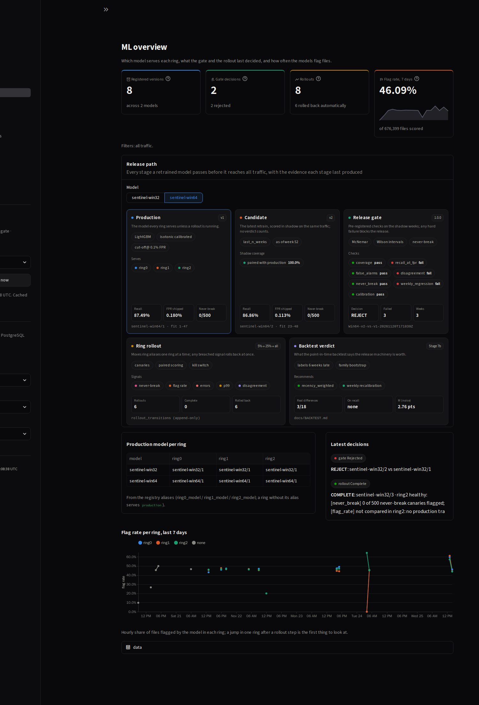
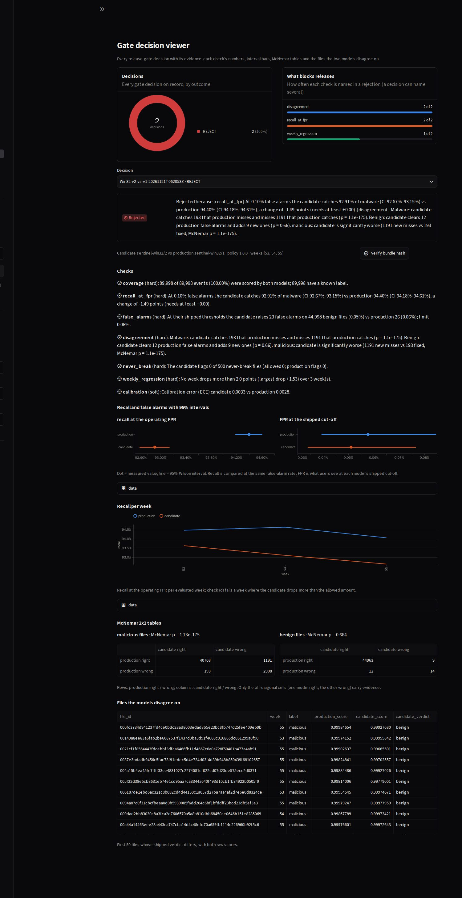
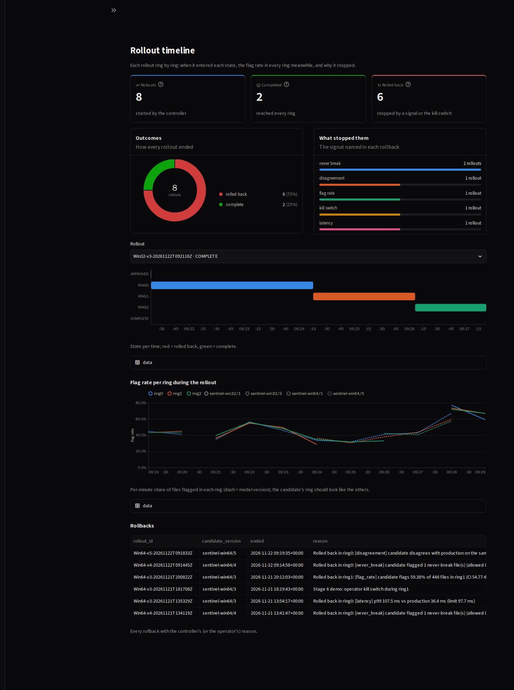
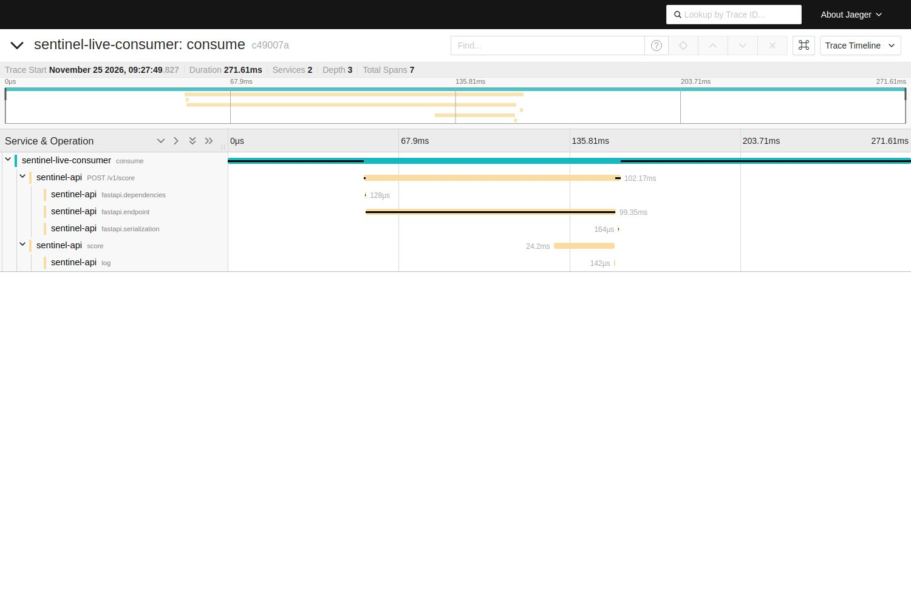
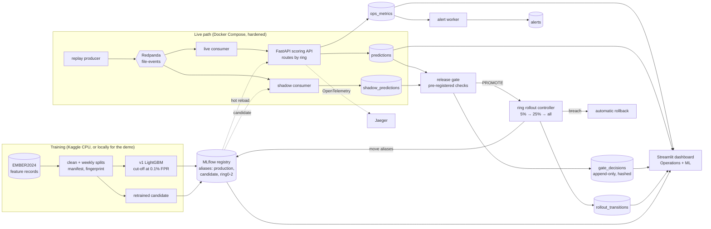

<div align="center">

# 🛡️ Sentinel Gate

**Safe releases for malware-detection models.**

Decide whether a retrained detector is safe to ship, roll it out ring by ring, and roll it back automatically.


[What it does](#what-it-does) · [How it works](#how-it-works-the-life-of-one-release) · [Strengths](#strengths) · [Screenshots](#screenshots) · [Quick start](#quick-start) · [Architecture](#architecture) · [Docs](#documentation)



</div>

---

## The problem

Malware detectors decay. New families appear, benign software changes, so models are retrained every few weeks. A retrained model can look better on validation data and still be **worse in production**. It can:
- miss more malware at the same false-alarm rate;
- flag files that must never be flagged;
- or simply behave very differently from the model users rely on.

Shipping every retrain blindly is easy. Noticing a bad one is not.

## What it does

Sentinel Gate treats a model release like a production change:

| Step | What happens | Where |
|:-:|---|---|
| 1. **Shadow** | The candidate scores live traffic next to production; users only see production's verdicts | Redpanda → live + shadow consumers |
| 2. **Gate** | Pre-registered statistical checks at a fixed **0.1% false-positive rate**: recall, shipped FPR, never-break files, weekly floor, McNemar, calibration | `make gate` → hashed, append-only `gate_decisions` |
| 3. **Roll out** | Ring by ring, **5% → 25% → everyone**, watching canaries, flag rate, errors, latency and disagreement | `make rollout` |
| 4. **Roll back** | Automatically on any breach, plus a kill switch that restores every ring in **0.65 s** | `POST /admin/rollback` |
| 5. **Record** | Every decision with its seed, data fingerprint and git commit, in append-only tables | PostgreSQL triggers |
| 6. **Question itself** | A point-in-time backtest asks whether all this machinery is actually worth it | [BACKTEST.md](docs/BACKTEST.md) |

It is built on the public **EMBER2024** feature records (Win64 and Win32 PE files). **No malware binaries are ever downloaded or run**: only pre-extracted numeric feature vectors.

> **Try it in one command:** `make demo` builds the whole release path on a small dataset in an isolated stack, in about 9 minutes ([Quick start](#quick-start)).

## How it works: the life of one release

Here is what happens to a model, from raw data to everyone's traffic, and which part of the code does it.

**1. Data comes in and is split by time.**
- EMBER2024 gives each Windows file as a vector of about 2,500 numeric features, plus a label (malware or benign), a malware family and the week it was first seen.
- The cleaning pipeline ([src/sentinel/data/](src/sentinel/data/)) checks every row against a Pandera schema and logs the row count before and after each step. It writes one Parquet file per week, plus a `manifest.json` with a data fingerprint.
- It also sets aside 500 **never-break** files: well-known benign files that no model may ever flag.

**2. A production model is trained.**
- v1 is a LightGBM model, trained on weeks 1–47 and calibrated on weeks 48–51.
- Its cut-off is not 0.5. It is the score at which only **0.1% of benign files** would be flagged, because in malware detection false alarms on real software are the costly mistake.
- The model is registered in MLflow under the alias `production`.

**3. Live traffic is scored.**
- A replay producer streams the held-out test weeks (53–64) onto a Redpanda topic, as if files were arriving from customers.
- The **live consumer** sends each file to the FastAPI scoring service. The service picks the model for that customer's **ring** (a stable hash of the tenant ID), returns a verdict and writes a lineage row to PostgreSQL.
- Every request also leaves a trace in Jaeger and a measurement in `ops_metrics`.

**4. A retrained candidate shadows production.**
- Every few weeks a candidate is retrained, using only labels that would really be known by then.
- It is registered as `candidate`. The **shadow consumer** scores the exact same events with it and stores the results separately.
- Customers never see the candidate's verdicts, so a bad candidate costs nothing yet.

**5. The release gate decides.**
- Labels arrive late, so the gate waits until they are known for the weeks it judges.
- It then compares both models file by file, on the same traffic, against rules fixed in advance ([gate_policy.yaml](configs/gate_policy.yaml)):
  - Is recall at 0.1% FPR at least as good?
  - Does it keep the false-alarm rate?
  - Does it flag zero never-break files?
  - Does it drop sharply in any week?
  - Are the disagreements statistically real (McNemar)?
- The verdict (`PROMOTE`, `REJECT` or `INSUFFICIENT_EVIDENCE`) and all its evidence are hashed into the append-only `gate_decisions` table, with a readable report in [docs/gate/](docs/gate/).

**6. The rollout controller ships it in rings.**
- On `PROMOTE`, the controller points ring0 (5% of customers) at the candidate. The API hot-reloads within seconds.
- It watches never-break canaries, flag rate, error rate, latency and how often the two models disagree.
- If every signal holds for enough files, it moves on to ring1 (25%), then ring2 (everyone).
- **Any breach rolls every ring back to the previous model.** An operator can also hit the kill switch. Every transition is recorded in `rollout_transitions`.

**7. Everything stays visible.**
- An alert worker checks latency, errors, consumer lag and never-break hits.
- The Streamlit dashboard shows all of it in one place: service health, each model's position in the release path, why the gate decided as it did, and each rollout's timeline.

**8. The system questions itself.**
- A point-in-time backtest ([BACKTEST.md](docs/BACKTEST.md)) replays 18 retrains under several release policies, with labels 6 weeks late.
- It asks whether this machinery actually ships better models than simpler options.

## Strengths

- **Ships safely by design.** Candidates prove themselves in shadow on real traffic before any customer sees them, then reach 5%, 25% and finally everyone.
- **Fast, automatic recovery.** A deliberately bad model was caught by never-break canaries in ring0 after **27.5 s** and rolled back. The kill switch restored every ring in **0.65 s**.
- **Decisions you can defend.** Every gate rule is written down and versioned before it runs. Every decision stores its full evidence, seed, data fingerprint and git commit, and `make gate-verify` re-hashes stored decisions to detect tampering.
- **No leakage.** Every split, threshold and decision uses only information available at that moment. Labels arrive late on a seeded delay, and a test fails if a test-week row appears in training ([data rules](#data-rules-no-leakage)).
- **Sound statistics in one place.** The core metrics (Wilson intervals, the threshold at a target FPR, AUC/AUPRC, calibration error, cluster bootstrap and McNemar) are pure functions in [evaluate.py](src/sentinel/models/evaluate.py), checked against textbook values and sklearn. Services and dashboards import them; nothing re-implements them.
- **Resilient serving.** Scoring never waits on the database: lineage goes through a bounded queue (`make db-outage-check`). Replaying a week twice never duplicates rows. Load testing recorded 0 failures and 0 lost lineage rows.
- **Full observability without extra tooling.** 12 dashboard pages, traces for every request and alert rules, built on PostgreSQL, Jaeger and Streamlit alone.
- **Secure by default.** Every tool and service runs non-root on a read-only filesystem with all capabilities dropped. Ports bind to localhost, images are pinned, each component has its own least-privilege database role, audit tables are append-only, and gitleaks runs on every commit.
- **Easy to try.** `make demo` builds the whole release path in an isolated stack in about 9 minutes, without touching the real one.
- **Configurable, typed and tested.** Every number lives in typed YAML config; `mypy --strict` passes; unit and integration tests cover the code with about 94% coverage.
- **Honest about itself.** [LIMITATIONS.md](docs/LIMITATIONS.md) lists the 10 weakest points of the code, tests and claims, and what would fix each.

## What we found

| Question | Answer |
|---|---|
| Does the safety net work? | Yes. A bad model was rolled back automatically in **27.5 s**, and both real gate decisions rejected retrains that missed significantly more malware (−0.63 and −1.49 recall points, McNemar p < 1e-77) ([ROLLOUT_DEMO.md](docs/ROLLOUT_DEMO.md), [docs/gate/](docs/gate/)). |
| What improves the model most? | **Weekly capped recalibration** removes the real false-alarm gap. **Recency-weighted retraining** beats a sliding window at 4 of 6 retrains. No release policy differed on recall ([BACKTEST.md](docs/BACKTEST.md)). |

## Screenshots

The Streamlit dashboard has 12 pages in four sections (Observe, Intelligence, Enforce, Operate). Everything below is the real Win64/Win32 stack with real numbers.

<table>
<tr>
<td width="50%"><b>Overview: is the service healthy?</b><br><sub>Traffic, verdict mix, flag rate per ring and busiest tenants, during a replay of 30,000 events.</sub><br></td>
<td width="50%"><b>Gate Decisions: why was a release blocked?</b><br><sub>Outcomes, the checks that block most, interval bars, McNemar tables and disagreeing files.</sub><br></td>
</tr>
<tr>
<td><b>Rollout Timeline: what happened in each rollout?</b><br><sub>Outcomes, rollback signals, each ring's state over time.</sub><br></td>
<td><b>Experiment Results: is the machinery worth it?</b><br><sub>The Stage 7b backtest: recall per policy, training windows, which differences are real.</sub><br></td>
</tr>
<tr>
<td colspan="2"><b>One request in Jaeger:</b> the consumer's span, the API's <code>POST /v1/score</code>, then <code>score</code> → <code>log</code> (271.6 ms, 7 spans).<br></td>
</tr>
</table>

## Quick start

**You need:** Docker Desktop (Compose v2) and GNU Make. On Windows, use Git Bash with `MSYS_NO_PATHCONV=1`. You also need about 30 GB free **outside** any OneDrive-synced folder. No host Python is needed: every tool runs in a hardened sandbox image.

```bash
# 1. configure (never committed; .env.example holds placeholders only)
cp .env.example .env
#    SENTINEL_DATA_DIR=C:/Users/<you>/sentinel-data      (outside OneDrive)
#    one strong random password per database role         (openssl rand -hex 24)
#    SENTINEL_ADMIN_API_KEY=<random>                      (kill switch)

# 2. build the sandbox and check everything
make setup          # sentinel-sandbox:dev: non-root, read-only, no network
make lint test      # ruff + mypy --strict + unit tests
make secrets-scan   # gitleaks, pinned, read-only

# 3. the fast path: the whole release path on a small dataset (~9 min)
make demo           # PDF splits -> v1 + candidate -> isolated stack -> replay 12 weeks -> gate
make demo-rollout   # optional (+1.5 min): a bad model, rolled back in ring0 by canaries
make demo-down      # remove the demo stack
```

The demo runs in its **own** compose project (`sentinel-demo`, data in `$SENTINEL_DATA_DIR/demo`) and never touches the real stack:

| Demo service | URL |
|---|---|
| Dashboard | http://127.0.0.1:8502 |
| API | http://127.0.0.1:18081 |
| MLflow | http://127.0.0.1:15000 |
| Jaeger | http://127.0.0.1:16687 |

The demo uses smaller models and a 1% FPR gate, because a PDF week has only about 500 benign files ([configs/demo/](configs/demo/README.md)). **It demonstrates the pipeline; it is not a result.**

<details>
<summary><b>The full Win64/Win32 run</b> (Kaggle training, real stack, release path)</summary>

Downloading, cleaning and training on about 2 million records run in **Kaggle/Colab notebooks** from a code-only bundle:

```bash
make bundle         # dist/sentinel_gate_code.zip (no data, no .env, no .git)
```

Upload it as a Kaggle dataset, run the notebook for the stage you need ([notebooks/](notebooks/)), download the result zip, then register it locally:

```bash
make train BUNDLE=/path/to/sentinel_stage2_Win64.zip              # v1 -> alias `production`
make import-replay ZIP=/path/to/sentinel_stage4_replay_Win64.zip
make register-candidate BUNDLE=/path/to/sentinel_stage4_candidate_Win64.zip
```

Copy zips to a path without spaces first. Then start the stack and exercise the release path:

```bash
make up                                 # build sentinel-app:dev and start every service
make rollout-init                       # ring0/1/2 aliases -> production
make test-integration

make replay WEEKS="53 54 55" EPS=300    # stream test weeks: live + shadow scoring
make gate CANDIDATE=2                   # release decision -> docs/gate/*.md + gate_decisions
make gate-verify                        # re-hash stored decisions (tamper check)
make rollout CANDIDATE=2                # ring-by-ring rollout with automatic rollback
make rollout-status
make kill-switch REASON="operator test"
make down
```

Dashboard: http://127.0.0.1:8501 · Jaeger: http://127.0.0.1:16686 · MLflow: http://127.0.0.1:5000 · API: http://127.0.0.1:18080

</details>

## Architecture



**The model.**
- v1 is LightGBM, trained on weeks 1–47 and calibrated on weeks 48–51, with week 52 held out.
- EMBER2024 has 52 training weeks and 12 test weeks (53–64).

**Observability** deliberately uses PostgreSQL `ops_metrics`, Jaeger and Streamlit only: no Prometheus, no Grafana.

<details>
<summary><b>Services</b></summary>

Every container is hardened: read-only root filesystem, all capabilities dropped, `no-new-privileges`, non-root user. Ports bind to `127.0.0.1` only.

| Service | Role | Local URL |
|---|---|---|
| `api` | FastAPI scoring, 4 uvicorn workers. Hot-reloads models from MLflow aliases, routes by ring, writes lineage | http://127.0.0.1:18080 |
| `postgres` | `predictions`, `shadow_predictions`, `gate_decisions`, `rollout_transitions`, `ops_metrics`, `alerts` (audit tables append-only via triggers) | 127.0.0.1:5432 |
| `mlflow` | Model registry (SQLite + file artifacts in `$SENTINEL_DATA_DIR/mlflow`) | http://127.0.0.1:5000 |
| `redpanda` | Kafka-compatible stream of file events (`file-events`) | internal |
| `live-consumer` / `shadow-consumer` | Score each event with production (through the API) and with the candidate | internal |
| `producer` | Replays test weeks onto the stream (`make replay`) | on demand |
| `jaeger` | Traces (consume → score → log) via OpenTelemetry | http://127.0.0.1:16686 |
| `alert-worker` | Consumer lag, alert rules, metric retention and downsampling | internal |
| `dashboard` | Streamlit: 4 Operations pages and 8 ML pages with shared filters | http://127.0.0.1:8501 |

Database roles: `sentinel_api`, `sentinel_shadow`, `sentinel_gate`, `sentinel_rollout`, `sentinel_monitor`, `sentinel_dashboard` (read-only).

</details>

<details>
<summary><b>The release gate</b> (<a href="configs/gate_policy.yaml">gate_policy.yaml</a>, version 1.0.0)</summary>

Every rule is fixed before it runs on the weeks it judges.

| Check | Rule |
|---|---|
| (a) Recall | Candidate recall at **0.1% FPR** ≥ production's |
| (a′) Shipped FPR | Candidate FPR at its shipped cut-off ≤ production's × 1.10 |
| (b) Evidence | ≥ 30 discordant files; McNemar at 95% confidence; ≥ 99% of events carry both a live and a shadow score |
| (c) Never-break | 0 never-break files flagged |
| (d) Weekly floor | In no week does recall fall more than 2 points below production's |
| (e) Calibration (soft) | ECE increase ≤ 0.01 (reported; does not block) |
| Late labels | Decides 28 days after the last evaluated week, using only labels known by then |

Outcomes: `PROMOTE`, `REJECT`, `INSUFFICIENT_EVIDENCE`. A `PROMOTE` moves only the `candidate_approved` alias; it never touches `production` directly.

</details>

<details>
<summary><b>The ring rollout</b> (<a href="configs/rollout.yaml">rollout.yaml</a>)</summary>

Rings are assigned by a stable hash of the tenant ID: ring0 gets 5% of tenants, ring1 25%, ring2 the rest.

A ring advances only after the candidate has served at least 300 / 1,500 / 3,000 real files there, has scored all 500 never-break canaries, and passes every signal:

| Signal | Limit |
|---|---|
| Never-break canaries | 0 hits |
| Flag rate | ≤ +10% relative to production (Wilson bounds) |
| Error rate | 5xx ≤ 1% |
| Latency | p99 ≤ 2 × production's p99 + 25 ms |
| Paired-scoring disagreement | ≤ +1 point over the rate the gate approved |

Any breach rolls back immediately.

</details>

<details>
<summary><b>Scoring API</b></summary>

| Method & path | Purpose |
|---|---|
| `POST /v1/score` | Score one file: `{file_id, tenant_id, features[], feature_schema_version, event_id?}` → `score`, `verdict`, `model_version`, `threshold`, `override_applied`, `request_id` |
| `GET /v1/models` | Models loaded, per file type |
| `GET /v1/rings` | Version served per ring (header `X-Sentinel-Worker` names the worker) |
| `GET /v1/ops/stats` | Request and latency counters |
| `POST /admin/rollback` | Kill switch (requires `X-API-Key`) |
| `GET /healthz`, `GET /readyz` | Liveness / readiness |

Requests route by `feature_schema_version`; unknown fields get 422.

</details>

## Data rules (no leakage)

- **Test weeks (53–64) are never used** for training, tuning, thresholds or calibration of v1 or any reported baseline.
- **Late labels:** a model trained at time *T* uses only rows whose labels were known by *T*.
- **Retrained candidates:** may learn from any week labelled by *T*. Their threshold uses weeks ≤ *T*; they are judged only on weeks after *T*.
- **Backtest:**
  - labels arrive 6 weeks late, so a decision at week *t* sees labelled weeks ≤ *t* − 6;
  - the live cut-off may be recalibrated weekly on benign files labelled by *t*;
  - margins and thresholds are never tuned on the weeks they judge.
- **Reproducibility:** fixed seeds. Every result file records the seed, the data fingerprint and the git commit.

## Security and safety

- **No malware binaries, ever.** Only `joyce8/EMBER2024` feature records; never the EMBER2024-capa dataset (raw function bytes).
- **Hardened sandbox for every tool:**
  - uid 10001;
  - read-only root and source mounts;
  - `--cap-drop=ALL` and `no-new-privileges`;
  - pid, memory and CPU limits;
  - `--network=none` except for the download step.
- **Hardened services:** localhost-only ports and pinned image digests.
- **Secrets** live only in `.env` (git-ignored) and are never echoed by `make`. gitleaks v8.21.2 runs as a pre-commit hook, and `make secrets-scan` scans the working folder.
- **Untrusted downloads** (Kaggle result zips) are checked against an allow-list and SHA-256 before import.
- **The kill switch** needs an API key, compared in constant time.

## Development

- **Language and tooling:** Python 3.11 with `uv` (`uv.lock`); `mypy --strict` on `src/`; `ruff` for lint and format.
- **Logging and config:** `structlog` JSON logging, with no `print` in `src/`. All settings in [configs/*.yaml](configs/), loaded through typed Pydantic models; no magic numbers.
- **Unit tests** cover:
  - every cleaning rule and pipeline determinism;
  - the evaluation maths against textbook values and sklearn;
  - gate, rollout state machine, serving, replay, monitoring, dashboards and backtest;
  - a golden v1 metrics test.
- **Integration tests** run against the live stack: stores, roles, append-only triggers, every dashboard query and end-to-end scoring.

```bash
make lint                      # ruff check + format check + mypy --strict
make test                      # unit tests with coverage
make up && make test-integration
make help                      # every target
```

<details>
<summary><b>All make targets</b></summary>

| Group | Targets |
|---|---|
| Setup & quality | `setup`, `sandbox`, `lock`, `lint`, `format`, `test`, `test-integration`, `secrets-scan` |
| Demo | `demo`, `demo-rollout`, `demo-down` |
| Data | `download`, `inspect`, `report`, `data`, `clean-data`, `cleaning-report`, `bundle` |
| Models | `train BUNDLE=`, `baseline-report`, `train-smoke` |
| Stack | `up`, `down`, `migrate`, `sample-request` |
| Replay & shadow | `import-replay ZIP=`, `register-candidate BUNDLE=`, `replay WEEKS=`, `replay-counts`, `replay-check` |
| Gate | `gate CANDIDATE= [FILE_TYPE=] [GATE_WEEKS=]`, `gate-verify` |
| Rollout | `rollout-init`, `rollout CANDIDATE= [DEMO=1]`, `rollout-watch`, `rollout-status`, `kill-switch`, `rollout-timeline OUT=`, `demo-models`, `demo-reset` |
| Experiment | `v1-zip`, `experiment-import ZIP=`, `experiment [RESAMPLES=]` |
| Backtest | `backtest-import-meta ZIP=`, `backtest-import ZIP=`, `backtest-pass1 [RESAMPLES=]`, `backtest-pass2 [RESAMPLES=]` |
| Observability & dashboards | `dashboard`, `dashboard-check [LOOKUP=<file_id>]`, `ml-results`, `load-bodies`, `load-test`, `load-report`, `load-bench`, `load-render`, `profile-api`, `db-outage-check` |

</details>

<details>
<summary><b>Configuration files</b></summary>

| File | Controls |
|---|---|
| `data.yaml`, `clean.yaml` | Dataset source, file types, cleaning rules, never-break rule, late-label delay |
| `train.yaml` | Training/calibration windows, target FPR, LightGBM/LR parameters, MLflow names |
| `serving.yaml` | Alias, poll interval, workers, lineage batching, overrides |
| `replay.yaml` | Stream topics, ring shares, tenants |
| `retrain.yaml` | Retraining policies (`last_n_weeks`, `all_history`, `recency_weighted`) |
| `gate_policy.yaml` | Release-gate rules (versioned) |
| `rollout.yaml` | Ring thresholds, canaries, health signals |
| `experiment.yaml` | Stage 7 experiment |
| `backtest.yaml` | Stage 7b: label delay, harm margin, recalibration cap, P4, blend, drift |
| `monitoring.yaml`, `alert_rules.yaml` | Metric windows, tracing, retention, alert rules, dashboard |
| `demo/*.yaml` | Demo overlay, deep-merged when `SENTINEL_CONFIG_OVERLAY=demo` |

</details>

<details>
<summary><b>Repository layout</b></summary>

```
configs/                 YAML configuration (one file per concern; demo/ overlay)
docker/                  sandbox.Dockerfile (uvbase / runtime / app), postgres init SQL + roles
docker-compose.yml       local stack (ports parameterised for the demo)
docs/                    plan, progress, decisions, reports, gate evidence, rollout timelines, img/
loadtest/                Locust scenario
notebooks/               Kaggle/Colab notebooks for the heavy stages (0, 1, 2, 4, 7, 7b)
scripts/                 CLI entry points behind every make target (incl. demo.sh)
src/sentinel/
  data/                  EMBER readers, cleaning rules, schema, pipeline, splits, reports
  models/                training, calibration, evaluate.py (all statistics), registry, retraining
  serving/               FastAPI app, model loading, rings, lineage, overrides
  replay/                producer, live/shadow consumers, event format
  gate/                  release-gate checks, evidence bundles, CLI
  rollout/               controller state machine, store, CLI (rollout / kill switch / timeline)
  experiment/            Stage 7 scoring tables, simulation, report
  backtest/              Stage 7b metadata, Pass 1, Pass 2, report
  monitoring/            metrics, tracing, consumer lag, alerts, retention, worker
  dashboard/             Streamlit app, queries/transforms, theme, UI kit, pages
  config.py logging.py provenance.py
tests/unit, tests/integration, tests/golden
```

Data never lives in the repo: it sits in `$SENTINEL_DATA_DIR`.

</details>

<details>
<summary><b>How it was built, stage by stage</b></summary>

| # | Stage | What it delivers |
|---|---|---|
| 0 | Repo & dataset check | Sandbox, tooling, verified downloads (SHA-256), [DATASET_REPORT.md](docs/DATASET_REPORT.md). Win64 + Win32 chosen: only they have ≥ 50,000 benign test files, enough to measure 0.1% FPR |
| 1 | Cleaning & data contracts | Pandera schema, logged row counts per step, weekly Parquet splits, a fingerprinted manifest, a 500-file never-break set, simulated late labels ([CLEANING_REPORT.md](docs/CLEANING_REPORT.md)) |
| 2 | Baseline models | LightGBM + LR, threshold at 0.1% FPR, Wilson intervals, ECE, MLflow `production` alias, golden-metrics test |
| 3 | Serving | FastAPI, hot reload by alias, lineage, tenant overrides, health probes |
| 4 | Replay & shadow | Redpanda stream; live and shadow consumers, idempotent on `event_id` |
| 5 | Release gate | Pre-registered checks, McNemar, hashed evidence in append-only `gate_decisions` |
| 6 | Rollout & rollback | Per-ring aliases, never-break canaries, Wilson-bounded signals, auto-rollback state machine, kill switch |
| 7 | Main experiment | 18 candidates (3 retraining policies × 6 retrain weeks) under 3 release policies, bootstrap CIs |
| 7b | Point-in-time backtest | 6-week label delay, family-clustered bootstrap, measured noise margin, capped recalibration, P1–P4, walk-forward, blend, drift |
| 8 | Observability & load | `ops_metrics`, OpenTelemetry → Jaeger, alert rules, retention, ops dashboard, Locust |
| 9 | ML dashboard | Registry, gate evidence with hash check, head-to-head, drift, rollout timeline, experiment results, prediction lineage |
| 10 | Hardening & handover | `make demo`, config overlay, gitleaks, dashboard SQL tests, reviewer pass ([LIMITATIONS.md](docs/LIMITATIONS.md)) |

</details>

## Known limitations

- **Load target not met:** 306 req/s and p99 above 20 ms, against 500 req/s and p99 below 20 ms ([LOAD_TEST.md](docs/LOAD_TEST.md)).
- **Narrow evidence:** one file type (Win64), one 12-week stream, 18 candidates. Intervals are wide.
- **The gate is too conservative:** it blocked better candidates and decides late. P4 as specified shipped nothing ([BACKTEST.md](docs/BACKTEST.md)).
- **Data that does not exist:** EMBER2024 has no early labels (that analysis is simulated and marked) and no signer identity.
- **No CI:** GitHub Actions left out by owner decision. Tests run when someone runs `make`, and pre-commit hooks run on commit.
- **Unbounded lineage:** `predictions` and `shadow_predictions` have no retention policy yet.

The full reviewer pass is in [LIMITATIONS.md](docs/LIMITATIONS.md).

## Documentation

| Document | Contents |
|---|---|
| [BUILD_PLAN.md](docs/BUILD_PLAN.md) | The stage-by-stage plan and execution protocol |
| [PROGRESS.md](docs/PROGRESS.md) | Status, per-stage plans, real check output, handoff notes |
| [DECISIONS.md](docs/DECISIONS.md) | One line per decision: what, why, the alternative rejected |
| [DATASET_REPORT.md](docs/DATASET_REPORT.md) · [CLEANING_REPORT.md](docs/CLEANING_REPORT.md) | Measured dataset counts; every cleaning step with row counts |
| [BASELINE.md](docs/BASELINE.md) | v1 metrics, intervals, calibration |
| [docs/gate/](docs/gate/) | Release-gate evidence (Markdown + hashed JSON) |
| [ROLLOUT_DEMO.md](docs/ROLLOUT_DEMO.md) · [docs/rollout/](docs/rollout/) | Rollout demonstrations with full transition tables |
| [RESULTS.md](docs/RESULTS.md) | Stage 7 experiment (conclusions superseded by 7b) |
| [BACKTEST.md](docs/BACKTEST.md) | Stage 7b point-in-time backtest (Pass 1 + Pass 2) |
| [LOAD_TEST.md](docs/LOAD_TEST.md) | Load test measurements |
| [LIMITATIONS.md](docs/LIMITATIONS.md) | Reviewer pass: the 10 weakest points |
| [configs/demo/README.md](configs/demo/README.md) | What the demo overlay changes and why |

<div align="center"><sub>Built on the public <a href="https://huggingface.co/datasets/joyce8/EMBER2024">EMBER2024</a> feature records. No malware binaries were used.</sub></div>
