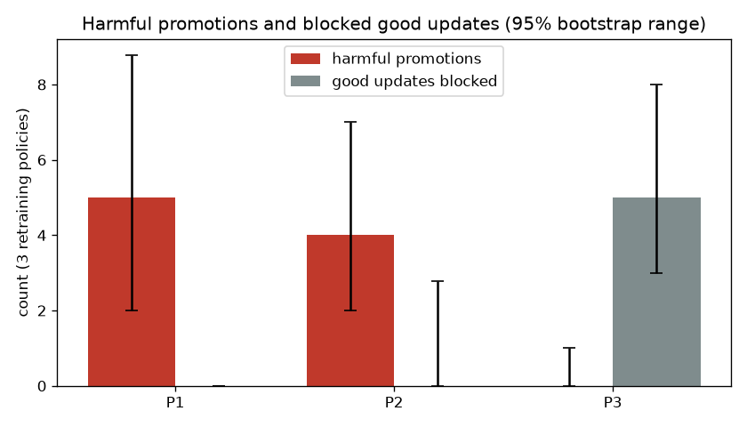
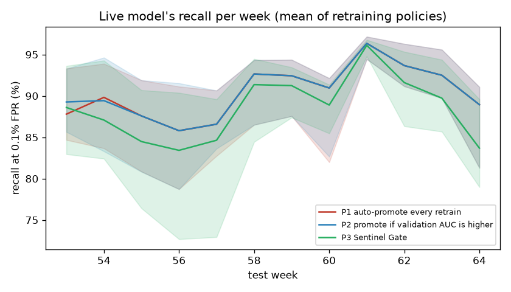

# Results (Stage 7)

<!-- experiment:auto:begin -->

Real stream; in brackets the 95% range over 50 bootstrap resamples. Counts are summed over the three retraining policies.

| Release policy | Promotions | Harmful promotions | Harmful share | Good updates blocked | Mean recall at 0.1% FPR | Mean FPR at shipped threshold |
|---|---|---|---|---|---|---|
| P1 auto-promote every retrain | 18 (18-18) | 5 (2-9) | 27.8% (11.1-48.7) | 0 (0-0) of 13 (9-16) | 90.42% (88.70-91.42) | 0.098% (0.080-0.124) |
| P2 promote if validation AUC is higher | 17 (14-18) | 4 (2-7) | 23.5% (11.8-43.2) | 0 (0-3) of 13 (9-15) | 90.51% (88.67-91.49) | 0.102% (0.083-0.131) |
| P3 Sentinel Gate | 2 (0-2) | 0 (0-1) | 0.0% (0.0-100.0) | 5 (3-8) of 7 (4-8) | 88.40% (87.23-90.00) | 0.203% (0.171-0.238) |

Per retraining policy (real stream): promotions / harmful / good updates blocked.

| Retraining policy | P1 auto-promote every retrain | P2 promote if validation AUC is higher | P3 Sentinel Gate |
|---|---|---|---|
| all_history | 6 / 1 / 0 | 6 / 1 / 0 | 1 / 0 / 2 |
| last_n_weeks | 6 / 2 / 0 | 5 / 1 / 0 | 0 / 0 / 1 |
| recency_weighted | 6 / 2 / 0 | 6 / 2 / 0 | 1 / 0 / 2 |

Drift alerts (P1 candidates, real stream): 1 alerts on 18 candidates, 0 of them harmful (precision 0%, bootstrap 0%-100%); 5 harmful candidates in all (base rate 28%, recall 0%).

<!-- experiment:auto:end -->

## Conclusions

> **Superseded in part by the Stage 7b point-in-time backtest ([BACKTEST.md](BACKTEST.md)), 2026-11-25.**
> - **Harm definition:** with labels 6 weeks late, a harm margin from measured week-to-week noise (M = 2.76 points) and family-clustered CIs, none of the 6 "harmful" swaps below holds up. All are within noise.
> - **Gate timing:** the gate timing used here (decision at T+6) used shadow labels before they existed.
> - **Recall:** no release policy is better on recall within the CIs.
>
> The conclusions below are kept as written for the record; read them with that correction.

Setup (from `configs/experiment.yaml`): Win64, 6 retrain weeks (T = 52, 54, ..., 62) × 3 retraining policies = 18 candidates. Each policy is replayed on test weeks 53-64 from v1. "Harmful" means the promoted model's recall at 0.1% FPR, over the 4 weeks after it went live, is below that of the model it replaced (margin 0), or it flags a never-break file. The P3 gate ran unchanged: no setting was tuned on these weeks. The gate needs 2 shadow weeks plus 28 days for labels, so it decides at T+6.

1. **Auto-promotion shipped a worse model 5 times in 18 (28%, bootstrap 11-49%), and a validation-AUC check stopped only one of them (P2: 4 of 17).** Validation AUC on the candidate's own calibration weeks says little about the next four weeks. Every harm was small: a recall loss of 0.09 to 0.58 points. None of the 18 candidates flagged a never-break file.

2. **The gate promoted nothing harmful (0 of 2), but it blocked 5 of the 7 candidates that turned out better, so on this stream it cost more than it saved.** All 7 rejections came from its disagreement check, which compares shipped verdicts. Candidates recalibrate their threshold on recent, partly labelled weeks (for example 0.99999865 for `all_history_T54` vs 0.99993932 for `all_history_T52`). A higher threshold makes a candidate drop hundreds of production's detections at the shipped threshold, even when its recall at a matched 0.1% FPR is higher. The check is doing its job, saying "this model behaves very differently". But "different" is not the same as "worse", and the gate cannot yet tell them apart. This finding does not favour the gate. Fixing it would mean changing the gate policy, which needs new validation weeks, not these test weeks.

3. **Holding back has a measurable price.** P3 kept older models live for longer:
   - mean recall at 0.1% FPR was 88.4%, against 90.4-90.5% for P1/P2;
   - mean FPR at the shipped threshold roughly doubled, to 0.20% against 0.10%, because v1's fixed threshold drifts (weekly FPR from 0.14% to 0.42%) while retrained candidates are recalibrated.

   The harms P1 caused were smaller (at most 0.58 recall points over 4 weeks) than the recall P3 gave up by being cautious.

4. **The gate is slow.** Deciding at T+6 means only the T = 52, 54 and 56 candidates were decided before the stream ended: 9 of 18 were never decided. Where P3 did act, it got the call right for the two harmful-looking `last_n_weeks` candidates (T52, T54), which it rejected. It promoted `all_history_T52` and `recency_weighted_T52`, and both were better.

5. **Drift alerts did not predict harm.** PSI on v1's top-20 features and on scores raised 1 alert across 18 P1 candidates, on a candidate that turned out fine. It caught none of the 5 harmful ones (precision 0%, recall 0%). At these thresholds the drift monitor gives no useful signal for release decisions.

**How far these results reach:**
- one file type (Win64) and one 12-week stream;
- harm counts are small, so the bootstrap ranges are wide (P3's harmful share is 0-100% with only 2 promotions);
- a margin of 0 means tiny recall differences count as "harmful";
- bootstrap resamples re-draw files within each week; they do not create new weeks or new drift.
